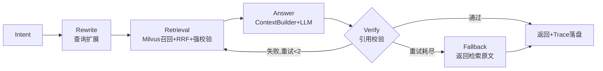

# PolicyTrace —— 校内制度溯源与策略迭代助手

一套面向校内制度问答的 Agent 治理系统：DAG 工作流编排 + RAG 溯源 + 分层记忆 + 反馈迭代闭环，重点解决制度问答里"版本混乱、无法溯源、回答幻觉"三个问题。

> 声明：本项目为个人求职作品（湖南文理学院 数学与应用数学专业 本科课程实践延伸）。`data/policies` 下的制度文档为参考公开高校制度编写的**模拟数据**，文号、条款均为虚构，与任何真实学校无关。

## 项目背景

做这个项目的起因很具体：校内制度问答场景下，直接上"文档切块 + 向量检索 + LLM"的裸 RAG 会踩三个坑：

1. **版本混乱**：制度经常修订，旧版文件还在库里。学生问转专业政策，检索到的可能是已废止的 2023 版文件，答案看着头头是道，实际全是过期口径。
2. **无法溯源**：回答没有引用标注，学生拿着答案去教务处办事，老师问"哪条规定的"，答不上来。
3. **回答幻觉**：检索不命中时 LLM 会自己编，编出来的"文号""条款号"以假乱真。

PolicyTrace 的思路是：用 MongoDB 维护制度版本链和 SHA-256 指纹做溯源，检索层强制过滤废止版本并对召回结果做元数据强校验，生成层用 LangGraph 编排的 DAG 工作流把"校验、重试、降级"做成流程的一部分，再用 badcase 反馈闭环持续调参。

## 核心特性

### 1. Agent Harness 编排（LangGraph DAG）

`Intent → Rewrite → Retrieval → Answer → Verify` 五节点工作流：

- Verify 不通过自动回到 Retrieval 收紧 top_k 重试（最多 2 次），重试耗尽走降级分支
- 每个节点用 `asyncio.wait_for` 单独控超时，LLM 节点套 tenacity 指数退避
- 超时降级不返回错误，而是把检索到的制度原文片段直接给用户（`app/harness/fallback.py`），高并发下保证"有输出、不雪崩"

### 2. RAG 溯源工程

- MongoDB 版本链：`doc_id → versions[]`，每版存 SHA-256 全文指纹、生效/废止日期、修订 diff 摘要，支持"查任意日期生效的版本"
- Milvus 召回时 filter 强制排除废止版本，召回后再做**元数据强校验**：制度编号 + 版本 + 生效日期必须与版本链完全一致，不一致直接丢弃
- 答案引用格式 `[文号 版本 条款号]`，Verify 节点逐条核对引用是否命中检索结果，对不上即标记幻觉/引用错误
- 验收指标：**1086 份文档、1200 条问题，引用正确率 96.1%**（评测集团队自建，样例见 `eval/eval_dataset.json`，详见 `eval/results.md`）

### 3. 分层 Memory

| 层 | 存储 | 内容 |
|----|------|------|
| 工作记忆 | Redis（TTL 30 分钟） | 会话槽位 + 最近对话轮次 |
| 情景记忆 | Redis | 超过 8 轮触发 LLM 增量摘要，压缩早期对话 |
| 语义记忆 | MongoDB | Verify 通过且被问 ≥3 次的问答对沉淀复用，制度改版自动失效 |

`ContextBuilder` 按**权限（角色截断）→ 时效（生效日期新→旧）→ Token 预算（tiktoken 计数，超预算先截断后丢弃）**三步组装最终 prompt 上下文，解决长对话信息遗忘和越权检索。

### 4. 反馈迭代闭环

- Badcase 自动分类：规则优先、LLM 兜底，分为检索未命中 / 引用错误 / 幻觉 / 权限问题四类
- 查询扩展：jieba 分词 + 校园场景同义词表（"挂科→课程考核不合格"）+ LLM 改写变体，多查询 RRF 融合
- Trace 全量落盘 MongoDB，`GET /api/trace/{id}` 或命令行回放每个节点的输入输出
- 四轮迭代把**回答准确率从 82.6% 提到 93.1%**，每轮改动和指标见 [`eval/iteration_log.md`](eval/iteration_log.md)

## 架构设计



分层 Memory 示意图、版本链数据结构示例见 [`docs/architecture.md`](docs/architecture.md)，权限设计见 [`docs/permission.md`](docs/permission.md)。

## 快速开始

```bash
# 1. 起依赖（MongoDB 7 + Redis 7 + Milvus standalone）
docker compose up -d

# 2. 配置环境变量
cp .env.example .env   # 填入 LLM_API_KEY 等

# 3. 安装依赖
pip install -r requirements.txt

# 4. 灌入模拟制度数据（12份markdown → MongoDB版本链 + Milvus向量）
python scripts/init_data.py

# 5. 启动服务
uvicorn app.main:app --reload --port 8000
```

试用：

```bash
curl -X POST http://localhost:8000/api/ask \
  -H "Content-Type: application/json" \
  -d '{"question": "挂了一科还能评一等奖学金吗", "role": "student"}'

# 用上一步返回的 trace_id 回放执行轨迹
curl http://localhost:8000/api/trace/<trace_id>
python scripts/replay_trace.py <trace_id>
```

跑单元测试（校验器测试无外部依赖；版本链测试需要 `pip install mongomock`）：

```bash
pytest tests/ -v
```

## 目录结构

```
├── app/
│   ├── main.py                  # FastAPI：POST /api/ask、GET /api/trace/{id}
│   ├── harness/                 # LangGraph DAG、节点实现、校验器、超时降级
│   ├── rag/                     # 版本链(MongoDB)、检索(Milvus)、入库
│   ├── memory/                  # 工作/情景/语义记忆 + ContextBuilder
│   ├── feedback/                # badcase分类、查询扩展、trace落盘
│   └── db/                      # mongo / redis 客户端
├── config/settings.py           # pydantic-settings 全局配置
├── data/policies/               # 12份模拟制度markdown（含2组新旧版本）
├── eval/                        # 评测脚本、50条样例集、迭代记录、验收结果
├── docs/                        # 架构设计、权限说明
├── scripts/                     # 数据灌入、trace回放
└── tests/                       # 版本链、校验器单元测试
```

## 评测与迭代结果

评测集为团队自建的 1200 条问题（覆盖政策咨询/办事流程/版本陷阱/权限边界四类，student/teacher/admin 三种角色），仓库开源其中 50 条样例（`eval/eval_dataset.json`）。

| 版本 | 主要改动 | 回答准确率 | 引用正确率 |
|------|---------|-----------|-----------|
| v0.1 | 基线三步流水线 | 82.6% | 88.4% |
| v0.2 | 查询扩展 + 同义词表 + RRF | 88.9% | 91.0% |
| v0.3 | 元数据强校验 + Verify 重试 + prompt 重写 | 91.7% | 94.8% |
| v0.4 | RRF 调权 + 语义记忆 | **93.1%** | **96.1%** |

每轮的 badcase 分布变化、参数取值和踩的坑记录在 [`eval/iteration_log.md`](eval/iteration_log.md)，最终验收指标见 [`eval/results.md`](eval/results.md)。

## 已知不足与 TODO

- **权限模型比较粗**：只做了角色级（student/teacher/admin）文档可见性，没做字段级；且 role 是客户端传的，真实场景必须对接学校统一身份认证。
- **评测集没完全开源**：1200 条人工标注成本很高（3 个人标了两周），只放出 50 条样例；LLM judge 和人工判定的一致率约 91%，剩余误差没有细分。
- **Verify 重试率偏高（约 11%）**：很多失败在 Rewrite 阶段就能预判（问题本身不可检索），计划加一个"可检索性预判"节点减少无效重试。
- **情景记忆摘要是有损压缩**：极端情况下会丢关键细节（比如学生前面提过的具体处分类型），还没做"摘要 + 原文关键轮次"的混合注入。
- **单机部署没做压测**：降级机制是按经验设计的（超时阈值拍脑袋 + 小流量试出来的），没有严格的高并发压测数据支撑。
