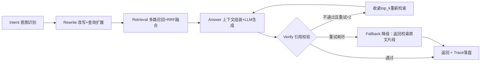
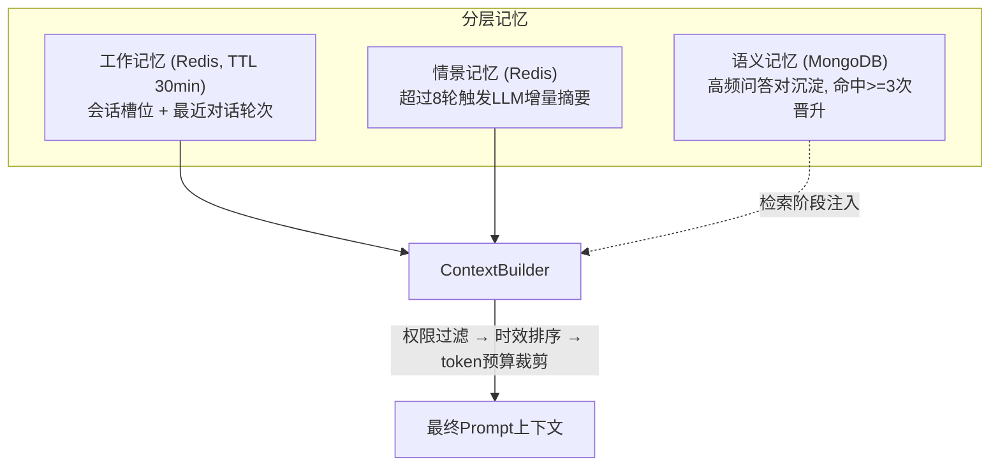

# 架构设计

## 整体 DAG（LangGraph）



要点：

- 每个节点用 `asyncio.wait_for` 单独控超时（见 `config/settings.py` 的
  `node_timeout_*`），超时/异常写入 trace 而不是把请求打挂
- Answer 节点调 LLM，额外套一层 tenacity 指数退避重试（2 次）
- Verify 失败重试时会收紧 top_k，让第二次检索更聚焦（v0.3 迭代的改动）
- 所有节点执行轨迹落 MongoDB，`GET /api/trace/{id}` 和
  `scripts/replay_trace.py` 都从这里读

## 分层 Memory



ContextBuilder（`app/memory/context_builder.py`）组装顺序：
对话背景摘要 → 最近 3 轮对话 → 制度原文片段（按生效日期新→旧排序，
tiktoken 计 token，超预算先截断后丢弃）。

## 版本链数据结构（MongoDB `policies` 集合）

一个制度一条记录，versions 数组挂全部历史版本：

```json
{
  "doc_id": "jxj",
  "title": "学生奖学金评定办法",
  "doc_no": "X校发〔2025〕12号",
  "versions": [
    {
      "version": "v1",
      "sha256": "9f2c...(全文指纹)",
      "effective_date": "2023-09-01",
      "revoked_date": "2025-08-31",
      "diff_summary": "初版发布",
      "status": "revoked"
    },
    {
      "version": "v2",
      "sha256": "a41d...(全文指纹)",
      "effective_date": "2025-09-01",
      "revoked_date": null,
      "diff_summary": "提高一等奖学金比例至8%；新增创新创业加分项",
      "status": "effective"
    }
  ]
}
```

- `get_effective_version(doc_id, date)`：查任意日期生效的版本
  （`effective_date <= date < revoked_date`），溯源场景用
- sha256 指纹用于校验"答案引用的内容和入库时的原文一致"
- Milvus 侧只保留 `status=effective` 的向量参与召回，废止版本在改版
  入库时由 `revoke_old_vectors` 下线；MongoDB 版本链完整保留

## 检索三道防线

1. Milvus filter 表达式只召回现行版本（`status == "effective"`）
2. 角色权限过滤：敏感制度对 student 截断到摘要（见 `docs/permission.md`）
3. 召回后强校验：chunk 的（制度编号、版本、生效日期）必须与 MongoDB
   版本链完全一致，不一致直接丢弃——防止改版后残留的旧向量混进上下文
